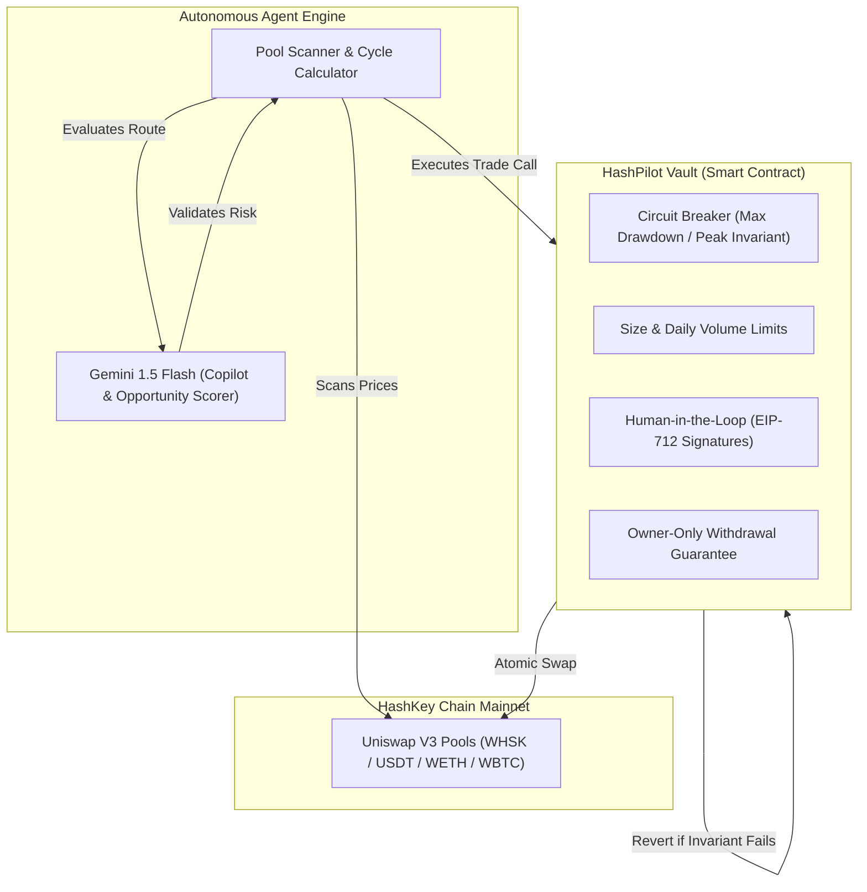

# HashPilot

> **The AI trades. The contract decides.**  
> An autonomous AI trading agent constrained by mathematical smart-contract mandates on **HashKey Chain Mainnet**.

---

## Executive Summary

**HashPilot** is a non-custodial smart-contract trading vault paired with an autonomous AI execution worker built specifically for the **HashKey Chain Mainnet**. 

Autonomous AI agents in Web3 offer incredible potential for identifying micro-inefficiencies and cross-pool arbitrage. However, giving an LLM or off-chain bot unrestricted wallet access creates catastrophic risks: prompt injection attacks, compromised bot private keys, slippage griefing, and hallucinated trades. 

**HashPilot solves this by decoupling opportunity intelligence from execution authority.** The AI agent is given restricted permission solely to submit trade proposals to the user's smart-contract vault. The smart contract acts as an immutable on-chain risk kernel: **any trade that violates user-defined risk parameters, maximum drawdown thresholds, slippage limits, or token whitelists is atomically reverted by the EVM.**

---

## The Problem

1. **The Custody Dilemma in AI Trading**: Traditional automated trading bots require users to either deposit capital into centralized custodial pools or hand over unrestricted private keys with unlimited ERC-20 allowances.
2. **Prompt Injection & Model Hallucinations**: When LLMs orchestrate financial actions, prompt injections or malformed inputs can trick the agent into routing swaps through malicious honeypot contracts or draining vault liquidity.
3. **MEV, Frontrunning & Slippage Griefing**: Unprotected DEX swaps on nascent liquidity pools often suffer severe slippage, sandwiched trades, or toxic order flow.
4. **No Graceful Human-in-the-Loop**: Existing platforms lack granular, cryptographic escalation workflows when an agent attempts unusually large or outlier trades.

---

## The HashPilot Solution

HashPilot enforces **defense-in-depth** across three cooperative layers:

### 1. Hard On-Chain Mathematical Invariants
- **High-Water Mark Drawdown Floor**: The vault tracks historical peak value (`highWaterMark`). The contract physically forbids any trade that drops vault equity below `peak - maxDrawdownBps` (e.g. 5% max drawdown).
- **Atomic Profit-or-Revert**: Trades are executed in an atomic flash-swap cycle. If the cycle fails to return the required minimum output tokens, the entire transaction reverts on-chain.
- **Rolling Daily Volume & Position Caps**: Trades cannot exceed the user's configured single-trade maximum nor daily volume budget.

### 2. Zero Agent Withdrawal Permissions
- The autonomous agent address possesses **zero transfer or withdrawal permissions**.
- Only the cryptographic vault owner (the user) can withdraw capital or pause the contract. Even if the agent's private key is leaked or compromised, an attacker cannot extract funds.

### 3. Human-in-the-Loop via EIP-712 Typed Signatures
- When an identified trade exceeds the user's autonomous approval threshold (e.g., trades over $2,500 USDT), the agent automatically queues an `ApprovalRequest`.
- The owner reviews the exact swap parameters, token route, and slippage in the HashPilot dashboard and approves it by signing an off-chain EIP-712 message with MetaMask—zero gas cost until submitted.

### 4. Asymmetric Timelock for Policy Changes
- **Safer Policy Changes** (e.g., reducing position limits, lowering max drawdown, removing risky tokens) take effect **instantly**.
- **Riskier Policy Changes** (e.g., increasing position sizes, adding volatile tokens) are placed into a **15-minute on-chain timelock** with plain-English diffs, giving owners time to cancel rogue changes.

---

## Key Features

- **Autonomous Multi-Token Arbitrage Engine**: Continually scans Uniswap V3 pools on HashKey Chain across multiple fee tiers (0.01%, 0.05%, 0.3%, 1.0%) for triangular and cyclical price spreads.
- **Gemini AI Copilot**: Interactive natural language interface powered by Google Gemini. Users can configure mandates conversationally ("Set my risk to conservative with max 3% drawdown"), review market spreads, and evaluate risk scores.
- **Dynamic Policy Diff Visualizer**: Color-coded policy comparison cards that evaluate parameter updates against on-chain safety invariants before transactions are signed.
- **Interactive Attack Simulator**: A built-in sandbox where users can simulate prompt injections, honeypot tokens, or rogue agent transactions to verify how the smart contract rejects them.
- **Real-Time On-Chain Indexer**: Background indexer polling HashKey Chain logs for deposits, withdrawals, swaps, circuit-breaker trips, and policy updates, displayed in an activity timeline.
- **Obsidian & Violet Pro UI**: State-of-the-art dark terminal design featuring responsive data tables, live gas estimations, and glassmorphic telemetry cards.

---

## HashKey Chain Mainnet Deployments

| Parameter | Mainnet Value |
|:---|:---|
| **Network Name** | HashKey Chain Mainnet |
| **Chain ID** | `177` (`0xb1`) |
| **RPC Endpoint** | `https://mainnet.hsk.xyz` |
| **Block Explorer** | [hashkey.blockscout.com](https://hashkey.blockscout.com) |
| **Native Gas Token** | `HSK` |

### Verified Smart Contracts

| Contract | Address | Explorer Link |
|:---|:---|:---|
| **HashPilot Vault (`RiskKernelVault`)** | `0x96569fFcb348670f39568AAda596e8f2775310Fd` | [View on Blockscout](https://hashkey.blockscout.com/address/0x96569fFcb348670f39568AAda596e8f2775310Fd) |
| **Uniswap V3 Swap Router** | `0x56d15cF00b5D853D6eE4CbB1463E6DAD2899fBf5` | [View on Blockscout](https://hashkey.blockscout.com/address/0x56d15cF00b5D853D6eE4CbB1463E6DAD2899fBf5) |
| **Uniswap V3 Factory** | `0x972cA9D1662F5e029cD18327D29026532E84c742` | [View on Blockscout](https://hashkey.blockscout.com/address/0x972cA9D1662F5e029cD18327D29026532E84c742) |
| **Autonomous Agent Address** | `0xBEdD38f260e3C936d0A743A57F211cde97f7401F` | [View on Blockscout](https://hashkey.blockscout.com/address/0xBEdD38f260e3C936d0A743A57F211cde97f7401F) |

---

## Whitelisted Tokens (HashKey Chain Mainnet)

| Asset | Token Symbol | Decimals | Contract Address | Role |
|:---|:---|:---:|:---|:---|
| **Tether USD** | `USDT` | 6 | `0xF1B50eD67A9e2CC94Ad3c477779E2d4cBfFf9029` | **Vault Base Currency** |
| **Wrapped HSK** | `WHSK` | 18 | `0xB210D2120d57b758EE163cFfb43e73728c471Cf1` | Cyclical Arbitrage Pair |
| **Wrapped Ether** | `WETH` | 18 | `0xefd4bC9afD210517803f293ABABd701CaeeCdfd0` | Cyclical Arbitrage Pair |
| **Wrapped BTC** | `WBTC` | 18 | `0x6119CA49a79f5825C8B345F8d7aC36B272565b14` | Cyclical Arbitrage Pair |

---

## Technical Architecture & Stack

- **Smart Contracts**: Solidity `^0.8.20`, OpenZeppelin Contracts (`ReentrancyGuard`, `Pausable`, `EIP712`, `SafeERC20`), Custom Invariant Engine.
- **Frontend**: Next.js 16 (App Router, Turbopack, Partial Prefetching, Cache Components), React 19, TypeScript.
- **Styling**: Tailwind CSS v4, Lucide Icons, Glassmorphic CSS Design System.
- **Web3 Integration**: `ethers.js v6`, MetaMask Provider, EIP-712 Typed Signing, SIWE (Sign-In with Ethereum) auth cookies.
- **AI Agent Intelligence**: Google Gemini API (`gemini-1.5-flash`), function calling for intent classification, structured JSON risk scoring.
- **Database & State**: PostgreSQL, Prisma ORM (Users, Vaults, Opportunities, Activity Events, Heartbeats, Approvals).
- **Background Worker**: Node.js worker loop with pool auto-discovery, cycle optimization math, slippage protection, and event indexing.

---

## How We Scale

HashPilot is architected from day one to scale across capital volume, liquidity venues, computational density, and institutional trust requirements:

### 1. Minimal-Proxy Vault Factory Architecture (ERC-1167)
- Instead of single-tenant deployments, HashPilot uses an **ERC-1167 minimal proxy (clone) factory**.
- Deploying a new, isolated smart-contract vault costs less than 45,000 gas on HashKey Chain.
- Each user maintains an independent contract instance with its own high-water mark, balance ledger, and mandate configuration—ensuring zero cross-vault contagion if a specific mandate is breached.

### 2. Multi-Venue DEX & Orderbook Aggregation
- While Phase 1 focuses on Uniswap V3 liquidity pools, HashPilot's modular router interface allows the contract to plug into:
  - Concentrated liquidity AMMs (Uniswap V3, PancakeSwap V3).
  - Standard constant-product pools (Uniswap V2 / HSKSwap V2).
  - On-chain central limit order books (CLOBs) and RFQ (Request-for-Quote) private market makers.
- The smart contract evaluates risk invariants purely against **input capital vs. output capital**, regardless of how many DEX hops or protocols are bundled within the atomic cycle.

### 3. Distributed Agent Worker Swarm
- The off-chain opportunity search engine scales horizontally using a **worker swarm model**:
  - **Scanner Nodes**: Dedicated microservices continuously monitoring mempools, block headers, and pool state ticks via high-speed WebSocket RPC feeds.
  - **Optimizer Nodes**: Concurrent execution workers solving optimal cyclical trade sizing and routing paths.
  - **Partitioned Execution**: Vaults are partitioned across execution workers based on asset class and mandate profile to prevent transaction collisions.

### 4. Verifiable Off-Chain Compute (Coprocessors & ZK-Proofs)
- As arbitrage graph complexity increases (e.g. 4-hop and 5-hop cyclical routes across dozens of pools), off-chain coprocessors calculate the optimal path and generate succinct cryptographic proofs.
- The vault contract verifies the route validity and invariant constraints on-chain in constant time ($O(1)$ verification cost), eliminating gas overhead from path calculations.

### 5. Institutional Custody & Standardized Vault Modules (ERC-4626)
- **Safe (Gnosis Safe) Integration**: Compatible with institutional multisig wallets where Safe modules act as the vault owner, requiring multi-party authorization for policy adjustments.
- **ERC-4626 Tokenized Share Vaults**: Expanding vault architecture to allow multiple liquidity providers to deposit into managed strategy pools with automated yield accounting and performance fee splits.
- **Automated Rebalancing**: Expanding beyond pure arbitrage into automated yield farming and peg-stability arbitrage inside contract-enforced risk boundaries.

---

## Security & Invariant Audit Matrix

| Attack / Failure Vector | Traditional Agent Bot | HashPilot Vault Enforcement |
|:---|:---:|:---|
| **Model Hallucination / Bad Trade** | Drains user balance | **Reverts atomically**: Mandate checks verify net return and max drawdown floor. |
| **Prompt Injection via Chat / Input** | Executes attacker payload | **Reverts on-chain**: The contract only accepts pre-whitelisted routers and tokens. |
| **Compromised Agent Key** | Full wallet drained | **Zero loss**: The agent key cannot transfer or withdraw funds; only the owner can exit. |
| **Flash Crash / Slippage Griefing** | High slippage execution | **Blocked**: Max slippage cap (`maxSlippageBps`) and minimum return checks revert toxic trades. |
| **Whale Trade / Capital Over-allocation** | Single trade risks portfolio | **EIP-712 Gate**: Trades above threshold require user's explicit cryptographic signature. |
| **Malicious Policy Tampering** | Instant compromise | **Timelock delay**: Risk-increasing policy edits require a 15-minute public timelock. |

---

## License

This project is licensed under the **MIT License**.
